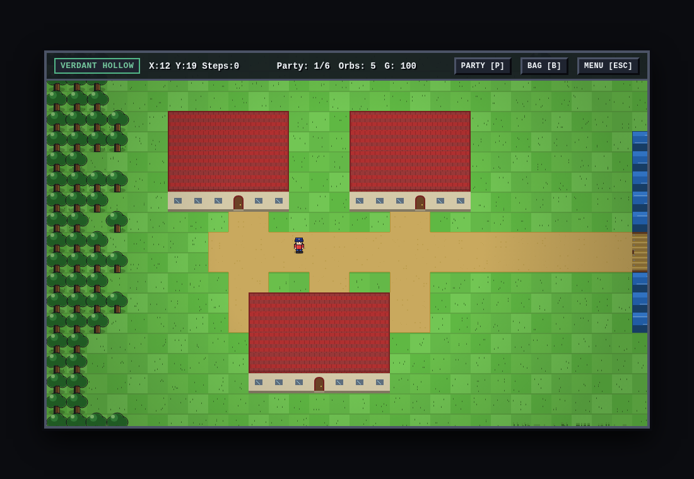
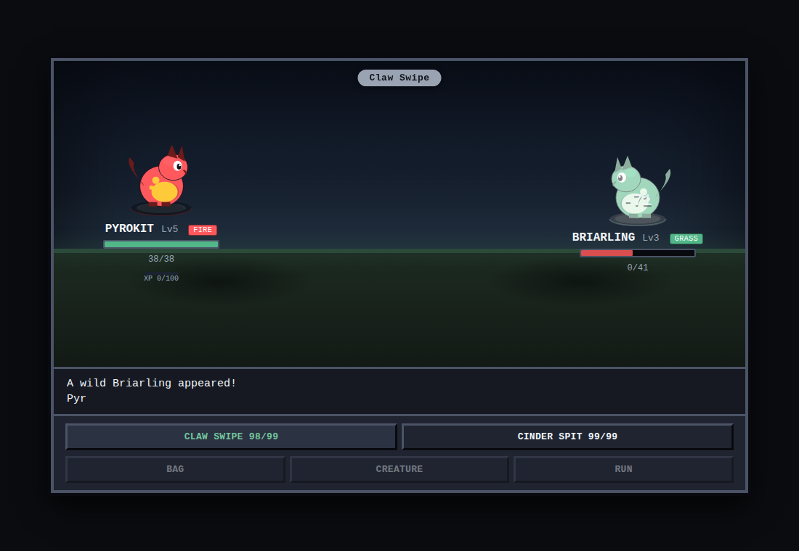
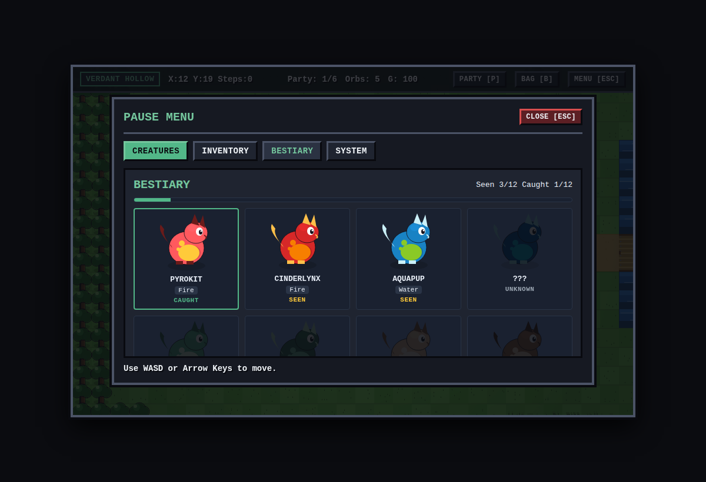
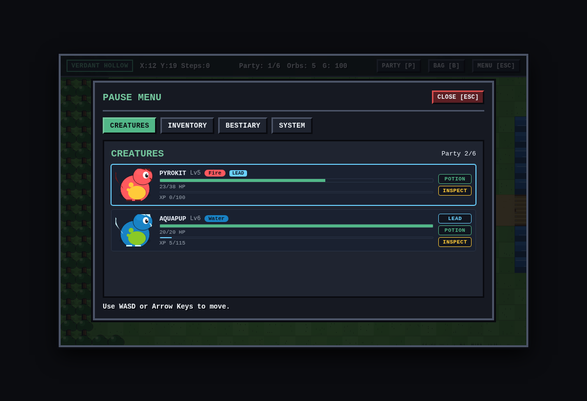
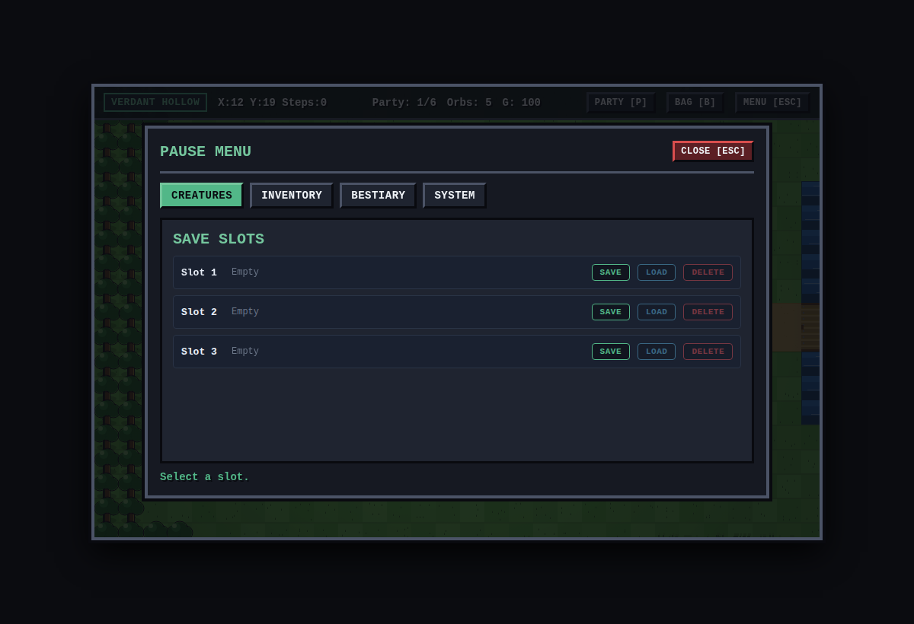

<div align="center">

# Aetheris
### Creature Chronicles

A 2D top-down creature-collecting RPG that runs in one browser tab with **zero
dependencies**. Every tile, sprite and effect is drawn procedurally on a Canvas, so the
whole game ships as text: no image files, no libraries, no CDN, no network calls.

[](#)
[](#)
[](#)
[](#-testing)
[](LICENSE)

**[Run it](#-run-it)** · **[Controls](#-controls)** · **[Features](#-features)** · **[How it was built](#-how-it-was-built)**

</div>



## About

You wake up in Verdant Hollow with no creature and no map. Tall grass hides twelve species,
each with its own palette, stats and moves. Walk into the grass and something will find you
first.

The game is deliberately small and deliberately complete: one map, one trainer, one bag, and
a battle system that resolves type matchups, PP, catching, fainting, switching, XP and
levelling without a single line of framework code.

## Screenshots

| Battle | Bestiary |
|---|---|
|  |  |

| Party | Save slots |
|---|---|
|  |  |

## Features

- **Overworld**: 60x40 hand-authored tile map, 120ms tween movement, collision, camera with
  clamping, tall grass encounters at 12% per step with varied species.
- **Battle**: turn-based, four moves per creature, PP, HP bars with colour states, damage
  from a full type chart, catching with catch rates, 50% escape by speed, faint and
  switching.
- **Progression**: wins award XP, `xpToNext(level) = 15 * level + 25`, and level-ups raise
  max HP and current HP by the same amount.
- **Bestiary**: all twelve species, procedural silhouettes for the ones you have not seen,
  live seen and caught counters, plus a detail panel with base stats, catch rate and moves.
- **Adventure Guide** built into the pause menu, so controls and mechanics are discoverable
  without leaving the game.
- **Three save slots** in `localStorage`, with validation, a two-step delete, and a refusal
  to load mid-battle or onto a solid tile.
- **Rendering**: three-tone shading with a top-left key light, outlines, ground shadows,
  animated water and grass driven only by time, and a depth sort so the player walks behind
  roofs and canopies.
- **Battle motion**: entrance slide-in, anticipation lunge, flinch, screen shake, floating
  damage numbers coloured by effectiveness, move banner, smooth HP drain, faint fade and a
  three-wobble catch.

## Run it

No build step, no install:

```sh
git clone https://github.com/pixie-chan/aetheris.git
cd aetheris
python3 -m http.server 8099
```

Then open <http://127.0.0.1:8099>. Any static file server works.

## Controls

| Input | Action |
|---|---|
| `WASD` / arrow keys | walk |
| walk into tall grass | roll an encounter |
| `1` `2` `3` `4` | use a battle move |
| `B` / `BAG` | bag, in battle |
| `P` / `CREATURE` | switch party member, in battle |
| `RUN` | try to escape |
| `Esc` | pause menu (Creatures, Inventory, Bestiary, System) |
| `Space` / click | advance dialog |

## Project layout

| File | Owns |
|---|---|
| `index.html` | canvas, HUD, dialog, pause menu, battle overlay |
| `style.css` | dark pixel theme for all DOM chrome |
| `js/data.js` | 12 species, move table, type chart, seeded RNG, map generation |
| `js/world.js` | camera, tiles, movement, encounters, HUD, dialog, pause menu hook, depth sort |
| `js/battle.js` | battle overlay, damage, catch, faint, XP and level-up, all battle motion |
| `js/dex.js` | Bestiary, Adventure Guide, save and load slots |
| `js/panels.js` | Creatures, Inventory and System tabs |

Load order is `data.js`, `battle.js`, `world.js`, `dex.js`, `panels.js`. Pause-menu screens
plug in through one contract: define `GAME.ui.<Name>()` and the menu finds it.

## Testing

Nine headless Chromium scripts, every one expected to report `PAGE ERRORS: none`:

| Script | Proves |
|---|---|
| `tools/smoke.py` | boots, drives input, asserts DOM and state |
| `tools/mapview.py` | prints the tile map as ASCII around spawn |
| `tools/battletest.py` | forces a battle, asserts overlay and buttons |
| `tools/catchtest2.py` | plays a battle, tries a ball |
| `tools/catchforce.py` | pins randomness to prove the catch success path |
| `tools/dextest.py` | Bestiary, silhouettes, detail strip, Guide, save round trip |
| `tools/battleprog.py` | one-shot win, XP rollover, level-up maths, live battle state |
| `tools/panelstest.py` | Creatures, Inventory, System tabs, including empty states |
| `tools/animtest.py` | entrance animation, damage number, banner, faint fade |

```sh
python3 tools/smoke.py
```

## How it was built

An orchestrator agent wrote **no game code**. It wrote specs, reviewed the returned files
against a checklist, applied them, and ran the harness. Web models did the implementation,
and every round was gated on the headless tests above.

| Round | Model | Delivered |
|---|---|---|
| 1a-1c | Gemini 4 Argon (web) | shell, styling, data tables |
| 2-3 | Claude Opus via `agy` | world, battle, art fixes |
| 4a | DeepSeek web | buildings render as houses, not hollow rings |
| 4b | DeepSeek web | Bestiary, Guide, Save and Load |
| 4c | DeepSeek web | full overworld graphics pass and depth sort |
| 4d | DeepSeek web | battle platforms, type badges, XP and level-up |
| 4e | DeepSeek web | Creatures, Inventory and System tabs |
| 4f | DeepSeek web | battle backdrop and entrance animation |
| 4g | DeepSeek web | lunge, flinch, shake, damage numbers, faint and catch motion |

Defects the orchestrator caught that the models did not notice themselves: encounters
re-spawning the same species because the RNG was re-seeded on every call, buildings rendering
as repeating walls, and file extraction swallowing a code fence's language label.

A longer engineering log lives in [docs/DEVELOPMENT.md](docs/DEVELOPMENT.md).

## Roadmap

- Per-species XP curves instead of one shared curve
- Creature evolution and move learning at level thresholds
- Interior maps behind the house doors
- A second route and a rival trainer battle

## License

[MIT](LICENSE). The code is yours to learn from. The twelve species, their names and the
region are original to this project.
